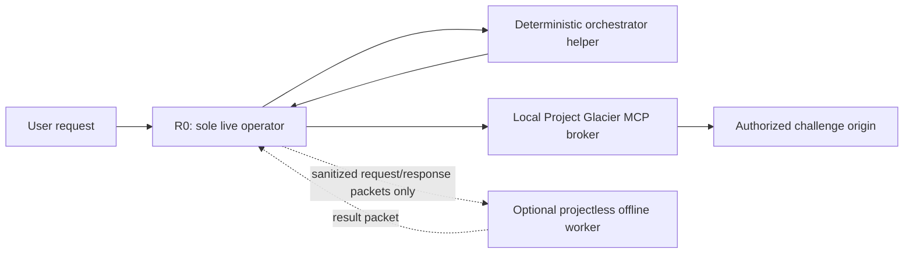

# Project Glacier control plane

This repository keeps the Project Glacier operating protocol, deterministic orchestrator, local
MCP broker, Codex configuration templates, custom-agent definitions, tests, and neutral runtime
artifact templates in one place.

It is a **control-plane repository**, not a bundle of reusable challenge state. Case IDs,
transcripts, operation IDs, delivery records, submission receipts, credentials, cookies, and the
current experiment ledger stay local and are deliberately excluded from Git.

Opening this repository does not start Project Glacier. Live work begins only after an explicit
user request and must follow `AGENTS.md` and the authoritative master prompt.

## What is included

| Area | Purpose |
| --- | --- |
| `project_glacier_master_orchestrator_prompt.md` | Authoritative single-root operating protocol |
| `project_glacier_multi_root_orchestrator_prompt.md` | Optional protocol-v2 offline-worker overlay |
| `project_glacier_offline_root_worker_prompt.md` | Isolated worker contract for the multi-root pilot |
| `project_glacier_orchestrator/` | Deterministic packet, checkpoint, outbox, and lifecycle helper |
| `.agents/skills/project-glacier-orchestrator/` | Repo-local Codex skill for the multi-root pilot |
| `mcp_server/` | Narrow STDIO MCP broker and its locked dependencies |
| `config/codex/` | Portable templates for local Codex and custom-agent registration |
| `templates/runtime/` | Neutral starting files for a new local workspace |
| `scripts/` | Safe initialization, configuration, and repository-boundary checks |
| `tests/` and `mcp_server/tests/` | Offline orchestrator and MCP test suites |

The root orchestrator is intentionally standard-library-only. The MCP component has its own
`pyproject.toml`, virtual environment, and committed `uv.lock`.

## How the pieces relate



- **R0** is the Codex task opened in this workspace. It is the only live operator and canonical
  writer.
- The **deterministic helper** validates and hashes local coordination state. It never calls
  Codex, Glacier, a browser, the network, or another external system.
- The **MCP broker** owns authentication, cookies, exact-origin transport, operation journaling,
  delivery ambiguity, single-case state, immutable submission previews, and quota accounting.
- The optional **offline worker** receives only sanitized protocol packets. It has no Project
  Glacier workspace or challenge access and cannot write canonical artifacts.

See [architecture](docs/ARCHITECTURE.md) for the detailed trust boundaries.

## Requirements

- Python `3.12`
- [`uv`](https://docs.astral.sh/uv/) for the MCP environment and locked dependencies
- macOS for the supported Keychain credential flow
- POSIX filesystem features used by the lock and no-follow file protections
- Access to the authorized corporate/VPN network when live challenge work is explicitly started

The MCP package locks `mcp[cli]` and Requests in `mcp_server/uv.lock`. Do not copy an existing
virtual environment between paths or machines.

## Set up a fresh clone

Keep the repository local or in an approved private location. No remote or license is configured
by this repository.

1. Create the MCP environment from the committed lock:

   ```bash
   uv sync --project mcp_server --dev
   ```

2. Initialize neutral local runtime artifacts:

   ```bash
   python3 scripts/initialize_workspace.py
   ```

   This step is for a fresh clone. It creates owner-only files and intentionally refuses to
   overwrite any existing checkpoint or artifact. The generated checkpoint is reconciliation
   locked: it does not claim that the broker is clean, authenticated, or ready to mutate.

3. Render machine-specific Codex registration from the portable templates:

   ```bash
   python3 scripts/configure_codex.py
   python3 scripts/configure_codex.py --check
   ```

   Generated `.codex` files contain absolute local paths, are mode `0600`, and remain ignored by
   Git. The script never reads a participant credential.

4. If the participant credential is not already in the configured macOS Keychain service, invoke
   the broker’s native no-echo setup command yourself:

   ```bash
   uv run --project mcp_server project-glacier-store-credential
   ```

   Never put the value in a prompt, Git file, command argument, log, or chat.

5. Start a new Codex task in this workspace, or restart Codex. MCP registrations are loaded when a
   task starts; changing the TOML files does not replace the registry of an already-running task.

For an existing workspace, do **not** run the initializer over live artifacts. The configuration
renderer is safe to run idempotently; use `--force` only after reviewing intentional local drift.

## Use the MCP broker without the orchestrator

The broker under `mcp_server/` can run by itself as a local STDIO MCP server. This is useful when
an MCP-capable host should call the seven guarded `glacier_*` tools directly without loading the
master prompt, deterministic helper, runtime ledgers, multiagent scheduling, or offline-worker
protocol.

MCP-only mode is a lower-level interface, not a replacement safety policy. The broker still
enforces the exact authorized origin, one unfinished case, unique operation IDs, write-ahead
journaling, delivery-unknown lockout, immutable submission hashes, and quota accounting. The MCP
client or human operator remains responsible for case selection, evidence review, adjudication,
and durable research records that the full orchestrator would normally manage.

1. Build only the broker environment and store the credential through the native no-echo command:

   ```bash
   uv sync --project mcp_server --dev
   uv run --project mcp_server project-glacier-store-credential
   ```

2. Register a local STDIO server in the MCP host. For Codex, the following is a minimal project
   registration; other MCP hosts need the equivalent command, arguments, working directory, and
   environment. Replace the absolute paths with the clone's real location:

   ```toml
   [mcp_servers.project_glacier]
   command = "/absolute/path/to/Project Glacier/mcp_server/.venv/bin/python"
   args = ["-m", "project_glacier_mcp.server"]
   cwd = "/absolute/path/to/Project Glacier/mcp_server"
   required = true
   startup_timeout_sec = 20.0
   tool_timeout_sec = 240.0

   [mcp_servers.project_glacier.env]
   GLACIER_KEYCHAIN_SERVICE = "project-glacier-user-id"
   GLACIER_ALLOW_SUBMIT = "false"
   GLACIER_STATE_DIR = "/absolute/path/to/Project Glacier/.glacier-state"
   ```

   The broker supplies and validates the authorized origin itself. Keep
   `GLACIER_ALLOW_SUBMIT = "false"` unless an explicitly authorized workflow needs submission.
   Never place the participant credential in this TOML file.

3. Restart or reload the MCP host. Running the Python command directly in a terminal starts a
   machine-facing STDIO protocol process; it is not an interactive shell.

4. Verify the offline MCP handshake without contacting the challenge:

   ```bash
   uv run --project mcp_server pytest -q mcp_server/tests/test_mcp_protocol.py
   ```

5. During authorized use, call `glacier_open_session` first, keep exactly one active case, give
   every message, submission, and reset a unique operation ID, and never retry an `UNKNOWN`
   delivery. The full tool list and broker state model are documented in
   [`mcp_server/README.md`](mcp_server/README.md).

For Codex specifically, `python3 scripts/configure_codex.py` renders the repository's complete
registration. MCP-only consumers may instead use the minimal registration above and omit
workspace initialization because the broker maintains its own state directory.

## Starting Project Glacier

A normal request uses the single-root protocol:

```text
Run Project Glacier using project_glacier_master_orchestrator_prompt.md.
```

That request must not create another Codex task.

Multi-root pilot mode is opt-in. The user must explicitly request multi-root mode **and** explicitly
authorize creation or reuse of the isolated projectless offline worker. The base master prompt
remains authoritative for every live, safety, delivery, adjudication, submission, reset, and
checkpoint decision.

## Validation

Repository boundary:

```bash
python3 scripts/validate_repository.py
```

Orchestrator and repository-tooling tests:

```bash
PYTHONPYCACHEPREFIX=/tmp/project-glacier-pycache \
  python3 -m unittest discover -s tests -v
```

MCP lint and tests:

```bash
uv run --project mcp_server ruff check --config mcp_server/pyproject.toml mcp_server
uv run --project mcp_server pytest mcp_server/tests
```

Validate the rendered consumer registration:

```bash
PROJECT_GLACIER_CODEX_CONFIG="$PWD/.codex/config.toml" \
  uv run --project mcp_server pytest -q mcp_server/tests/test_project_registration.py
```

The file `mcp_server/scripts/live_mcp_smoke.py` is **not** part of normal validation. It
authenticates and can create and reset a real challenge case. Run it only under the live master
protocol with explicit authority and reconciled state.

## Local state versus repository source

The following remain local and ignored:

- `.glacier-state/` broker lock and SQLite operation journal
- `.project-glacier-orchestrator/` coordination outbox and the sibling
  `.project-glacier-orchestrator.lock`
- generated `.codex/config.toml` and custom-agent TOML files
- `PROJECT_GLACIER_RESUME.txt`, `CURRENT_CHECKPOINT.md`, and populated `glacier_*.md` artifacts
- credentials, cookies, redirect tokens, authentication URLs, transcripts, and receipts
- virtual environments, caches, logs, build output, and generated render products

Neutral versions of the durable Markdown artifacts live under `templates/runtime/`. They are
schemas and safe starting points, not evidence of live state.

## Repository status and publication

The MCP source import is pinned in `mcp_server/SOURCE_REVISION`; see
[provenance](docs/PROVENANCE.md). The broker intentionally contains an exact allowlist for an
internal challenge origin. Keep this repository local/private unless its classification and an
approved private destination are confirmed.

No Git remote and no software license are selected here. Those are organizational decisions, not
safe defaults. See [security](SECURITY.md), [operations](docs/OPERATIONS.md), and
[contributing](CONTRIBUTING.md) before publishing or changing the broker boundary.
